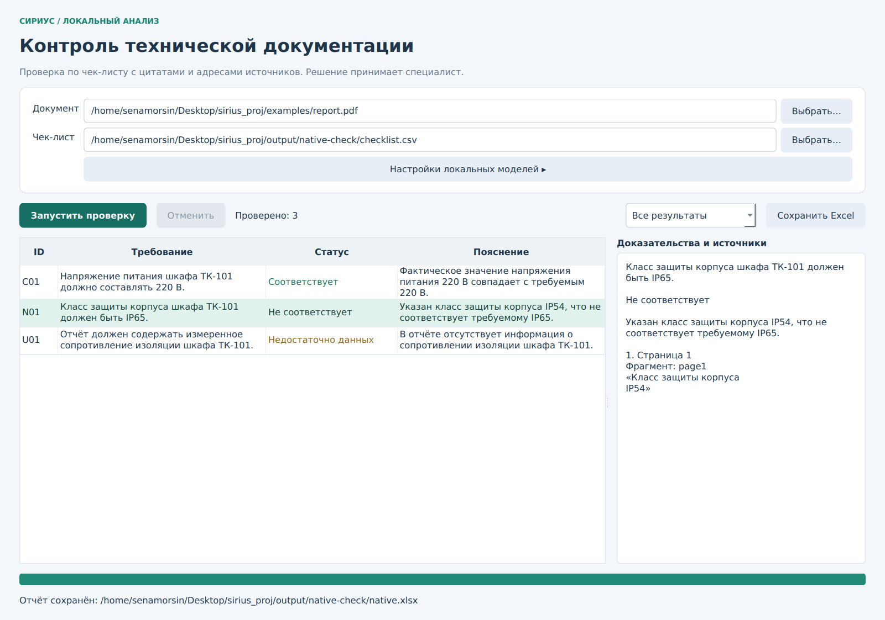

# Контроль технической документации

Настольное приложение для локальной проверки DOCX и текстового PDF по CSV-чек-листу.
Показывает статус, пояснение, сверенные цитаты и адреса источников; сохраняет Excel.
Окончательное решение принимает специалист.



## Запуск

В текущем рабочем каталоге всё уже подготовлено:

```bash
uv run sirius-proj
```

Для нового Ubuntu/Debian-компьютера:

```bash
uv sync
uv run python scripts/prepare_desktop.py
uv run python scripts/prepare_models.py
uv run sirius-proj
```

`prepare_desktop.py` загружает недостающую `libxcb-cursor0` в `runtime/qt` без sudo.
Это нативная [зависимость Qt для X11](https://doc.qt.io/qt-6/linux-requirements.html),
не проблема поиска самого плагина xcb. Если библиотека уже установлена системно,
этот шаг не нужен. Рабочее окно проверяется через X11, offscreen применяется только
к изолированным тестам виджетов.

Подготовка моделей требует интернета и примерно 5 ГиБ диска: E5 ONNX и Qwen2.5 7B
Q4_K_M плюс llama.cpp. Архив runtime удаляется после распаковки; сохраняются сервер,
библиотеки и лицензия. Повторный запуск не скачивает готовый runtime заново.
Во время проверки документы и ответы остаются на компьютере.

Используются Python 3.14 и PySide6 Essentials (без WebEngine, PDF и Addons).
Проверена Linux x86_64, Ryzen 7, 30 GiB RAM, RTX 5060 Laptop 8 GiB.
Для режима CPU снимите флажок GPU в настройках. Для компьютера без Vulkan:
`uv run python scripts/prepare_models.py --cpu`.

## Использование

Выберите `examples/report.pdf` или `examples/report.docx` и `examples/checklist.csv`,
запустите проверку и выберите строку результата для просмотра доказательств.
Пути к серверу и моделям доступны в настройках.

CSV — UTF-8 (допустим BOM), разделитель — запятая, уникальный ID и критерий в строке:

```csv
id,requirement
R1,Напряжение питания должно составлять 220 В.
R2,Класс защиты корпуса должен быть IP65.
```

| Статус | Основание |
|---|---|
| Соответствует | Факты подтверждают требование |
| Не соответствует | Найдено явное противоречие |
| Недостаточно данных | Оснований недостаточно или цитата не подтвердилась |

Технические ошибки учитываются отдельно. Excel содержит результаты, все доказательства
и предупреждения. Нумерация PDF — физические страницы с единицы; DOCX — абзацы
основного текста (включая заголовки и пустые абзацы), либо таблица и строка с единицы.

## CLI и проверки

```bash
uv run sirius-proj check examples/report.pdf examples/checklist.csv -o result.xlsx
uv run python scripts/evaluate.py
uv run python scripts/benchmark.py
uv run pytest --cov=sirius_proj --cov-report=json
uv run ruff check src tests scripts
uv run python scripts/quality.py
```

CLI и окно используют один `ReviewService`. Опции: `check --cpu`, `check --json файл.json`,
`--data-dir каталог`. Коды выхода: 0 — выполнено, 1 — ошибка запуска/сценария,
2 — в отчёте есть технические ошибки пунктов. Текущие диагностические прогоны и отчёты
качества пишутся в игнорируемый `output/`, а не накапливаются в исходниках.

На небольшом учебном наборе: DOCX 10/12 и PDF 12/12 совпавших статусов. Все цитаты
сверены. Это отладочная оценка, не гарантия точности на реальных отчётах.
[Протокол и ограничения](docs/VALIDATION.md), [эксперимент с mDeBERTa](docs/NLI_EXPERIMENT.md).

## Структура

- `domain/` — значения и чистая проверка доказательств.
- `application/` — сценарий и интерфейсы зависимостей.
- `adapters/` — файлы, поиск, локальная модель и XLSX.
- `ui/` — окно, таблица результатов и рабочий поток.
- `bootstrap.py` — сборка конкретных реализаций для GUI и CLI.

Подробнее: [архитектура](docs/ARCHITECTURE.md), [журнал](docs/WORK_LOG.md).

Материалы защиты сохранены в [defense](defense/README.md). Пересоздание исходников:
`uv run python scripts/create_defense.py`; PDF/DOC — `uv run python scripts/export_defense.py`
(нужны LibreOffice, Times New Roman и Arial). Реквизиты руководителей требуют заполнения.

OCR, анализ изображений, колонтитулов и текстовых полей DOCX, автоматическое построение
чек-листа и проверка оформления не реализованы. Самопроверка структуры записки пока
ненадёжна. Поиск может пропустить основание, модель — неправильно его истолковать.
Апробация на материалах куратора ещё не проведена.
